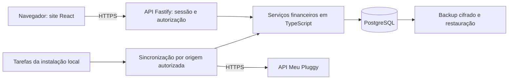

# Arquitetura e tecnologias do organizador financeiro

Esta arquitetura descreve a instalação local do Auto Finance e complementa os [requisitos](02-requisitos.md), as [decisões de segurança](05-seguranca.md) e o [plano de testes e CI](06-testes-e-ci.md).

A instalação usa React, TypeScript e Vite no navegador, Fastify na API e PostgreSQL local. O Fastify serve o build e a API na mesma origem em loopback. Cada instalação controla seus dados e suas credenciais opcionais de integração.

## 1. Como o Dinzo parece construído

O que se consegue reconstruir publicamente é a arquitetura de produto e as fronteiras de integração. As fontes consultadas não identificam os frameworks dos aplicativos e do painel, a linguagem do backend, o banco de dados ou o mecanismo interno de processamento.

| Parte | Evidência pública | Implicação para o projeto |
| --- | --- | --- |
| Clientes | Apps iOS e Android, painel web e Dino por WhatsApp. A API REST v1 atende integrações, e o MCP hospeda ferramentas com escopos de acesso. | As mesmas operações financeiras devem gerar o mesmo resultado em qualquer tela. Um cliente adicional poderá usar os mesmos serviços. [Produto](https://dinzo.com.br/), [Documentação](https://dinzo.com.br/docs), [Referência REST](https://dinzo.com.br/docs/reference) |
| Dados bancários | Pluggy fornece Open Finance em leitura. O Dinzo exibe saúde da conexão, estado de sincronização e dados conforme a instituição transmite. | Arquivo, inserção manual e conector bancário são entradas para o mesmo modelo. A lógica financeira continua disponível quando a fonte externa falha. [Open Finance no Dinzo](https://ajuda.dinzo.com.br/hc/central-de-ajuda-dinzo/articles/1787188740-o-dinzo-e-seguro-como-funciona-o-open-finance), [Sincronização](https://ajuda.dinzo.com.br/hc/central-de-ajuda-dinzo/articles/1787188721-meus-dados-nao-atualizam-o-que-fazer) |
| Infraestrutura | O produto de referência publica o uso de serviços gerenciados. | A instalação local reúne interface, API, banco e tarefas agendadas na máquina do operador. |
| Processamento | O arquivo enviado vai para uma fila, passa por leitura e categorização e fica disponível para revisão. O Extrato e os relatórios documentam tratamento de faturas, pagamentos, duplicidades e projeções. | O backend trata importação revisável, conciliação, ciclos e projeção. Tarefas mais demoradas podem rodar fora da requisição, com estado consultável pelo site. [Importação](https://ajuda.dinzo.com.br/hc/central-de-ajuda-dinzo/articles/1787188738-importar-extrato-pdf-csv-ofx-ou-excel), [Extrato e totais](https://ajuda.dinzo.com.br/hc/central-de-ajuda-dinzo/articles/1787188735-por-que-os-totais-nao-batem-e-como-ocultar-lancamentos) |
| Previsão | O saldo previsto combina saldos, entradas e compromissos. Uma assinatura no cartão entra no caixa pelo vencimento da fatura. A ajuda indica que o Dinzo trabalha com os compromissos conhecidos, sem projetar por médias. | A primeira entrega de planejamento prevê despesas recorrentes com valores fixos ou estimados manualmente. A projeção de saldo por conta é uma evolução separada. [Saldo previsto](https://ajuda.dinzo.com.br/hc/central-de-ajuda-dinzo/articles/saldo-projetado-e-fluxo-do-mes), [Recorrências](https://ajuda.dinzo.com.br/hc/central-de-ajuda-dinzo/articles/1787188738-recorrentes-e-assinaturas) |

Uma agregação central das operações financeiras é uma hipótese coerente com o comportamento dos clientes e os contratos da API. A documentação pública sustenta essa leitura funcional, sem revelar a topologia interna. Para chegar perto da experiência, os indicadores prioritários são extrato com filtros rápidos, faturas reconciliáveis, cartões com ciclos próprios e uma previsão que permite abrir a composição de cada valor.

## 2. Stack recomendada para o site

| Camada | Tecnologia | Motivo e trade-off |
| --- | --- | --- |
| Interface | **React + TypeScript + Vite**, CSS próprio e componentes acessíveis | Site responsivo. Atende extrato, filtros, formulários e painéis em computador e celular. Usar padrões próprios de navegação, densidade, cores e estados. [Vite](https://vite.dev/guide/) |
| API e regras financeiras | **Fastify + Node.js + TypeScript** | A API valida entradas, autoriza operações e chama o mesmo núcleo para faturas, rateios, recorrências e projeções. A interface consome os resultados calculados no servidor. [Fastify](https://fastify.dev/docs/latest/Guides/Getting-Started/) |
| Tabelas e gráficos | **TanStack Table** para extrato e **Recharts** para séries, comparativos e barras de orçamento | Tabelas com ordenação, filtros e paginação pelo banco. Virtualização quando o volume justificar. Gráficos exibem a diferença entre realizado e estimado e levam à lista de itens. [TanStack Table](https://tanstack.com/table/latest/docs/overview), [Recharts](https://recharts.github.io/en-US/guide/typescript/) |
| Banco | **PostgreSQL**, migrações SQL e consultas parametrizadas | Suporta transações, restrições e concorrência entre operações da interface e tarefas de integração. Use a mesma versão principal no uso local e nos testes. [Concorrência no PostgreSQL](https://www.postgresql.org/docs/current/mvcc-intro.html) |
| Importação e integração | Adaptadores no **backend**, **Papa Parse** como candidata para CSV e **Meu Pluggy** como candidata à sincronização | Validar cobertura com contas autorizadas pelo operador. Selecionar bibliotecas de OFX, Excel ou outros formatos depois de verificar amostras sintéticas representativas. |
| Sincronização | Tarefas do backend local com execução registrada no PostgreSQL | Atualizar enquanto o serviço estiver em execução. Usar uma execução por conexão, retentativas limitadas e reprocessamento idempotente. |
| Acesso local | Navegador, API e PostgreSQL em loopback | O navegador acessa a API na mesma origem do build. O servidor valida sessão e autorização para operações financeiras. [Segurança](05-seguranca.md) |
| Verificação | **Vitest**, **PostgreSQL** descartável e **Playwright** | Validar regras, API, migrações, autorização e fluxos no build. [Testes e CI](06-testes-e-ci.md), [Playwright na CI](https://playwright.dev/docs/ci) |

O backend modular serve a API e o build web na mesma origem local. O navegador chama operações como listar faturas, confirmar importação e atualizar um rateio. A API verifica a sessão, o espaço financeiro e os dados da operação. As tarefas de integração e a API usam os mesmos serviços financeiros.

### Distribuição e operação local

Cada instalação mantém configurações e credenciais próprias em seu ambiente local. O PostgreSQL pode ser executado diretamente ou pelo Compose. A configuração padrão publica o serviço de banco e a aplicação apenas em loopback.

Persistir dados no volume local e documentar migrações, backup e restauração. O usuário inicia o serviço quando quiser acessar a interface ou sincronizar fontes. [Backup do PostgreSQL](https://www.postgresql.org/docs/current/backup.html)

## 3. Os três recursos no modelo do app

### 3.1 Dividir uma despesa e acertar o saldo entre pessoas

A interpretação inicial de “dividir conta” é ratear uma despesa. Acesso compartilhado é uma decisão separada. O Dinzo Ultra documenta convidados com login e permissões. A atribuição a uma pessoa por final de cartão vale para as compras daquele final e a própria ajuda registra que ela não divide uma compra entre pessoas. [Acesso compartilhado](https://ajuda.dinzo.com.br/hc/central-de-ajuda-dinzo/articles/1787188731-usar-a-mesma-conta-com-outra-pessoa), [Cartão adicional e pessoas](https://ajuda.dinzo.com.br/hc/central-de-ajuda-dinzo/pt_BR/categories/cartao-de-credito-e-fatura).

O app precisa distinguir quem passou o cartão ou desembolsou, quem assume cada parte e quem usa o sistema. Uma compra pode ter um pagador e vários responsáveis. O rateio aceita valor fixo e divisão igual, e a divisão percentual é natural na mesma estrutura. Partes somam o total em centavos. Pode haver acerto parcial, vários acertos ou um único PIX para várias despesas, mediante vínculo explícito. O app acompanha o saldo entre pessoas e permite registrar o acerto quando acontecer.

**Exemplo.** Um mercado de R$ 240 passa no seu cartão e é dividido meio a meio. A fatura mostra uma cobrança de R$ 240. O plano Casa registra R$ 240 para a família. O relatório da sua participação mostra R$ 120 e o painel de acertos mostra R$ 120 a receber. Quando o PIX entrar na sua conta, ele afeta o caixa e baixa o acerto, sem inflar a receita da casa ou diminuir o total pago ao mercado. Em caso de estorno, reavaliar as parcelas do rateio e preservar os acertos já feitos, com eventual saldo a compensar.

### 3.2 Tela de Assinaturas com visão geral e navegação por cartão

O Dinzo já representa vínculos de assinaturas e recorrências com conta ou cartão. Na tela de Assinaturas descrita pelo usuário, esse vínculo não organiza visualmente a lista. O requisito é tornar a escolha do cartão parte da navegação da própria tela, inclusive para cartões cadastrados manualmente. [Recorrências](https://ajuda.dinzo.com.br/hc/central-de-ajuda-dinzo/articles/1787188738-recorrentes-e-assinaturas), [Saldo previsto](https://ajuda.dinzo.com.br/hc/central-de-ajuda-dinzo/articles/saldo-projetado-e-fluxo-do-mes).

- **Visão geral.** Mostra todas as assinaturas, com cartão ou conta identificado em cada linha e o total mensal consolidado. Uma assinatura sem cartão identificado continua visível com essa indicação.
- **Uma opção por cartão.** Abas ou cards selecionáveis, como **Visão geral**, **Cartão A** e **Cartão B**. Selecionar um cartão mostra suas assinaturas, com valor, próxima cobrança e subtotal mensal. A aba de um cartão sem assinaturas exibe um estado vazio.
- **Identidade do cartão.** Usar o cartão selecionado como filtro. Nome, titular e final, quando disponível, ajudam a distinguir cartões parecidos. Dois cartões podem ter listas separadas mesmo quando suas cobranças caem na mesma fatura.
- **Mesmos registros nas duas visões.** Editar uma assinatura em qualquer visão atualiza as duas. Se a cobrança mudar de cartão, o novo vínculo vale a partir da ocorrência indicada, com o histórico das cobranças anteriores preservado.

### 3.3 Previsão mensal de gastos recorrentes

A unidade do planejamento é a despesa nomeada pelo usuário, como **Conta de Luz**, **Conta de Internet** ou **Conta de Água**. Casa e Carro são agrupamentos opcionais. É possível acompanhar despesas individualmente, com ou sem grupo. O meio de cobrança pode ser uma conta, um cartão ou ficar a definir.

Uma despesa fixa, como internet, usa o valor contratado. Uma despesa variável, como luz, usa um valor de referência informado manualmente. É possível ajustar a estimativa só para um mês. Séries já cadastradas em Assinaturas e recorrências alimentam a previsão sem duplicar o cadastro.

Quando a conta chegar, o usuário pode confirmar seu valor antes do pagamento. Se já existir um lançamento efetivado, pode vinculá-lo à previsão. O resumo mensal mostra **estimativa original, valor confirmado, valor ainda estimado e variação**. O total atualizado soma os valores confirmados e as estimativas em aberto, contando cada cobrança uma vez.

Por exemplo, uma Conta de Luz estimada em R$ 180 e confirmada em R$ 205 entra no total atualizado por R$ 205 e mostra uma diferença de R$ 25. A previsão de saldo por conta, a contribuição das faturas pelo vencimento, as reservas, os tetos e as despesas fora das séries recorrentes ficam para revisão posterior. [Assinaturas e recorrências](14-assinaturas-e-recorrencias.md), [Requisitos](02-requisitos.md).

## 4. Modelo mínimo e invariantes

| Conceito | Relação importante |
| --- | --- |
| Pessoa | Pode ser titular, pagadora ou participante de um rateio. Permissão de acesso pode ser adicionada por vínculo separado. |
| Conta bancária, conta de crédito e cartão | A conta bancária movimenta caixa. A conta de crédito agrega fatura e limite. Um cartão identifica o instrumento e seu titular ou usuário. |
| Transação e ciclo de fatura | O fato realizado tem origem e identidade. Compras de crédito são vinculadas ao ciclo. Pagamentos e estornos têm vínculos explícitos. |
| Rateio e acerto | O rateio aloca uma transação a pessoas. O acerto baixa um saldo entre elas e pode apontar a um PIX importado. |
| Despesa prevista | A despesa pode ter um grupo opcional. A previsão mensal guarda valor de referência, ajustes, meio de cobrança e vínculo com o lançamento quando houver. |
| Série, ocorrência e confirmação | Uma ocorrência deriva de uma série ou de um item pontual. A transação conciliada é usada como realizado e substitui a expectativa correspondente na projeção. |
| Fonte e importação | O registro externo e as decisões de conciliação são rastreáveis por conta, origem e lote. Correções manuais persistem em novas importações. |

- Gravar valores em centavos inteiros, comparar valores exatos e repartir resíduos de arredondamento de forma determinística. Na integração, converter texto decimal antes de fazer cálculos.
- Tratar data da compra, data de vencimento e data real de pagamento como fatos separados. Regras recorrentes guardam o dia desejado e aplicam uma política definida para meses curtos.
- Somar uma transação uma vez na base escolhida. A assinatura, a regra, a fatura e o item do plano podem apontar para o mesmo compromisso.
- Gravar transações, rateios, vínculos e acertos em operações consistentes. Reimportar o mesmo movimento ou repetir a mesma conciliação preserva o resultado.
- Separar a visão de consumo, a visão de responsabilidade e a visão de caixa. Cada total informa o período, a base e as linhas que contribuíram.

## 5. O que aproxima a experiência do Dinzo

| Resultado esperado | Recorte suficiente para a primeira versão |
| --- | --- |
| Saber o que entrou, saiu e ainda vence | Visão geral com saldo, próximos vencimentos e projeção, com acesso às linhas que compõem cada número. Mostrar realizado e previsto visualmente e por texto. |
| Conferir cartões rapidamente | Na tela Assinaturas, alternar entre Visão geral e a lista de cada cartão. Na área de cartões, abrir a fatura, suas compras, parcelas e pagamentos. |
| Manter o histórico sem retrabalho | Importar de arquivo com prévia e conciliação. Preencher lançamentos frequentes por formulário rápido e regras de categorização locais. Open Finance é uma segunda forma de alimentar esse mesmo fluxo. |
| Acompanhar gastos previstos | Tela mensal com despesas recorrentes, estimativas editáveis e valores confirmados. Oferecer visão geral e agrupamento opcional e permitir abrir a cobrança conciliada. |
| Usar pelo navegador | Entrar e abrir o painel em computador ou celular. Salvar filtros no espaço financeiro, operar com teclado, exibir erros acionáveis e oferecer exportação de dados. |

Canais adicionais de captura, leitura de comprovantes e sincronização bancária têm custo de implementação próprio. A previsão financeira funciona com regras, dados manuais ou importados.

## 6. Ordem de implementação proposta

As fases, os primeiros PRs e os critérios de segurança estão no [plano de desenvolvimento seguro](08-plano-sdlc.md).

1. **Provas em paralelo.** Validar o fluxo local com navegador, Fastify e PostgreSQL usando dados sintéticos. Testar a integração opcional com credenciais da instalação e conforme a modalidade autorizada pelo provedor.
2. **Primeiro fluxo completo.** Cadastrar as duas pessoas e dois cartões. Importar ou registrar compras, fechar uma fatura e conciliar um pagamento parcial. Exibir os números por cartão e o extrato detalhado. Preparar as relações para cartões adicionais de uma conta de crédito.
3. **Recursos próprios.** Ratear uma compra, conciliar um reembolso, mudar a cobrança de uma assinatura para outro cartão nas próximas ocorrências e prever os gastos recorrentes do mês com valores manuais e cobranças confirmadas.
4. **Validar operação financeira.** Agendar atualizações quando a integração estiver habilitada. Isolar falhas por conexão e refinar importação, parcelas, filtros, categorias e previsão.
5. **Preparar instalação e atualização.** Testar instalação limpa, backup e restauração. Documentar inicialização, configuração local e atualização do banco.

O primeiro marco financeiro exige um ciclo com extrato conciliado, faturas, planejamento e totais verificáveis, usando registro manual ou importação. A sincronização bancária é uma capacidade opcional.
